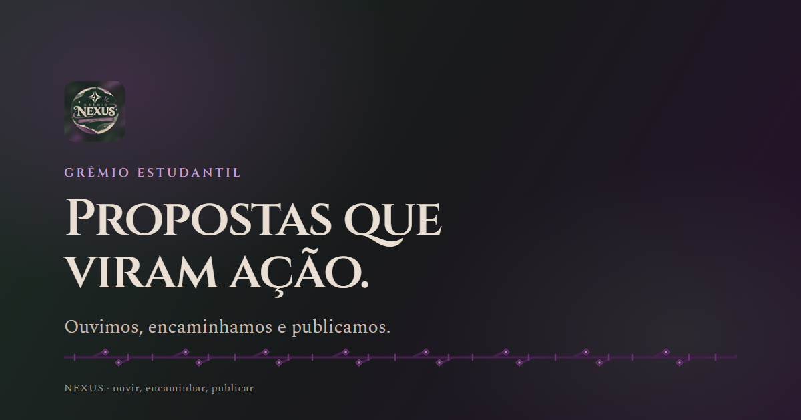

# NEXUS — Grêmio estudantil



> **Conectando ideias e construindo mudanças.** Chapa NEXUS · grêmio estudantil.

Página estática de apresentação do grêmio estudantil NEXUS. Direta ao ponto, mobile-first e sem cadastro: o foco é deixar claro o que a chapa faz e como a comunidade pode falar com a gente.


---

## 🌙 A ideia

Identidade **Lunar Forest** levada ao extremo editorial: fundo carvão `#100E16`, superfícies em roxo profundo `#1C1725`, acentos em violeta `#684C78` e lilás `#B99BCB`, tipografia clara `#D9D0DF` e um toque de musgo `#68745E`. A atmosfera é de floresta noturna **sem desenhar galhos, folhas ou flores**: o que resta é a lua, linhas de conexão e pontos de luz discretos.

Cinzel comanda os títulos e a marca; Spectral conduz a leitura. Cada seção tem uma composição própria — hero em duas colunas, manifesto, prioridades em escada, índice de propostas, contato em linhas, formulário aberto e chamada final em spread. As seis áreas e todas as propostas continuam no ar, com as três prioridades principais em destaque.

Tudo é HTML e CSS puro, sem frameworks. O JavaScript envia o feedback ao Supabase quando o deploy está configurado; sem configuração, mantém o protótipo local. Também gerencia o painel e fecha o menu mobile.

## ✨ O que tem

- Cabeçalho fixo com navegação por âncoras e menu mobile via `<details>`.
- Hero assimétrico, tipografia-first: **NEXUS** domina em degradê lilás→musgo, o slogan oficial vem logo abaixo e atalhos numerados convidam às três prioridades.
- Fundo do hero com lavanda e musgo mais presentes; lua maior, órbita mais nítida e campo de pontos sutil, sem galhos, folhas ou flores.
- Hero sem as duas barrinhas com pontos abaixo do botão; o motivo de conexão permanece apenas na chamada final.
- Botão principal em degradê lilás→branco-quente (`#D9D0DF`), com contraste alto sobre o fundo escuro.
- Prioridades em destaque sobre painéis planos e recuados: Voz e Transparência, Esporte e Competição, Cultura e Entretenimento.
- Outras propostas em índice discreto: Educação e Futuro, Bem-estar e Acolhimento e Período Noturno (complementar).
- Contatos: Instagram da chapa e WhatsApp de Esther Avelino e Igor Ryan, com link que abre a conversa no app.
- Barra de 6px entre as seções em degradê roxo→lilás→musgo, com um pequeno ponto claro de conexão.
- Símbolo lunar da Lucide (ISC) e motivo de conexão original: só retas e pontos.
- Formulário de feedback com validação real: envio ao Supabase quando configurado, ou mensagens salvas **apenas neste navegador** no modo local.
- Painel restrito por login do Supabase Auth no modo real; visitantes só enviam e somente a conta autorizada pela RLS lê, edita e apaga.
- Fontes Cinzel e Spectral hospedadas no próprio projeto.
- Tipografia ampliada e com contraste mais alto: corpo em 16 px, títulos maiores e textos secundários mais claros.
- Respiro extra entre o cabeçalho fixo e o início do conteúdo.
- Ao atualizar a página, a rolagem volta ao topo em vez de manter a posição anterior.
- Layout responsivo testado em 320, 390, 768 e 1188 px, sem overflow horizontal.

## 🚀 Ver online

**[valentinohoehne.github.io/Nexus-Chapa](https://valentinohoehne.github.io/Nexus-Chapa/)**

O deploy é automático a cada push em `main`. Com os Secrets do Supabase configurados,
o GitHub Actions gera `componentes/config.js` e publica no Pages. Sem eles, o site
continua no modo local. Passo a passo em [GUIA-SUPABASE.md](GUIA-SUPABASE.md).

## 🧱 Estrutura

```text
Nexus-Chapa/
├── index.html                 # entrada do site (precisa ficar na raiz para o Pages)
├── admin.html                 # painel das ideias (fora do menu do site)
├── README.md
├── GUIA-SUPABASE.md           # como criar projeto, tabela, usuário e Secrets
├── .github/workflows/deploy.yml # injeta a config pública e publica no Pages
├── componentes/
│   ├── config.js              # vazio no repo; preenchido no deploy pela Actions
│   ├── storage.js             # camada de dados e contrato do adapter
│   ├── supabase.js            # REST + Auth do Supabase usando só fetch
│   ├── script.js              # formulário + fechamento do menu mobile
│   └── admin.js               # login, lista, busca, edição, exclusão e CSV
├── supabase/setup.sql         # tabela, trigger de datas, índice e policies de RLS
├── estilos/
│   ├── styles.css             # paleta, composições, transições e responsividade
│   └── admin.css              # estilos exclusivos do painel
├── tests/
│   ├── storage.test.js        # testes do storage com node:test
│   ├── supabase.test.js       # testes do adapter com fetch falso (sem rede)
│   ├── config.test.js         # guard contra segredos no config.js
│   └── manual.md              # roteiro de verificação no navegador
└── assets/
    ├── fonts/                 # Cinzel e Spectral (self-hosted)
    ├── icones/                # lua da Lucide + conexão original + LICENSE.txt (ISC)
    ├── nexus-mark.png         # marca usada na navbar e no favicon
    └── nexus-og.png           # preview social (1200×630)
```

## 🛠 Como rodar localmente

Não há build, dependências nem etapa de instalação.

**Opção mais simples:** abra `index.html` no navegador.

**Ou com um servidor local estático:**

```bash
npx serve . -l 8765
```

Depois acesse `http://127.0.0.1:8765/` — a mesma origem usada no roteiro manual.

## 🎨 Onde mexer

| O que você quer mudar | Onde fica |
| --- | --- |
| Cores, tipografia e espaçamentos | `estilos/styles.css` (variáveis no `:root`) |
| Textos e seções | `index.html` |
| Barra entre seções | `estilos/styles.css` — `.doc > section::after` |
| Destaque das três prioridades | `estilos/styles.css` — `.priority` |
| Símbolos decorativos | `assets/icones/` (Lua Lucide ISC + conexão original) |
| Onde as ideias são salvas | `componentes/supabase.js` (modo real) ou `componentes/storage.js` (chave `nexus:feedback:v1`) |
| Ativar o envio real | `GUIA-SUPABASE.md` + Secrets `SUPABASE_URL` e `SUPABASE_PUBLISHABLE_KEY` |
| Regras de quem vê/edita/apaga | `supabase/setup.sql` (RLS) |

## ✅ Qualidade

- Lighthouse: **100** em acessibilidade, boas práticas e SEO.
- `overflow-x: 0` em 320, 390, 768 e 1188 px.
- Console sem erros; fontes e scripts carregando nos caminhos corretos.
- Respeito a `prefers-reduced-motion`.

## 🗂 Modo local e modo Supabase

Sem configuração (estado versionado), o formulário salva cada ideia no
`localStorage` e o painel em `http://127.0.0.1:8765/admin.html` lista, busca,
edita, exclui e exporta CSV.

- **Não é envio:** no modo local a mensagem fica só no navegador/dispositivo usado.
- **Origem importa no modo local:** `file://`, `localhost` e `github.io` são
  armazenamentos diferentes.
- **Modo real:** com `config.js` preenchido pela Actions, o envio vai ao Supabase;
  visitantes só inserem e o painel pede login. A sessão do admin fica só em memória,
  então recarregar a página pede login de novo. Ver [GUIA-SUPABASE.md](GUIA-SUPABASE.md).

Testes (sem rede): `node --test tests/`.

## 📌 Ainda provisório

- Ativar o envio real depende da criação do projeto Supabase e dos Secrets.
- Concorrência entre abas: a última escrita vence.
- Proteção contra inundação de envios anônimos (rate limit/CAPTCHA) fica para depois.

---

Feito para a comunidade escolar. 🌙
